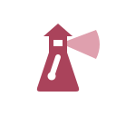

---
hide:
  - toc
---

<div class="sk-intro" markdown>
  <div class="sk-intro-copy" markdown>

<div class="sk-wordmark"><h1>Minot</h1></div>

<p class="sk-tagline">Debug and verify stateful<br>robot perception software.</p>

<p>Step through a bag like a debugger, replay it in real time, and run pub/sub
with or without ROS.</p>

<div class="sk-actions" markdown>

[Get started](intro/query.md){ .md-button .md-button--primary }
[Install](installation/ros.md){ .md-button }

</div>

  </div>
  <div class="sk-intro-visual" markdown>

```bash
minot sync query.mt   # step through a bag
minot async run.mcap  # replay in real time
minot coord           # pub/sub coordinator
```

  </div>
</div>

<div class="sk-highlights">
  <div><strong>Bags are queryable now</strong><span>Jump to any message and replay it into your node, step by step.</span></div>
  <div><strong>Deterministic pub/sub</strong><span>Peer-to-peer over TCP, with quality of service per node, publisher, service and action.</span></div>
  <div><strong>ROS optional</strong><span>Runs as a ROS node or on its own, from C++, Rust or Go.</span></div>
</div>

## About

**Minot**{ .small-caps } [mai·not] is a robot development toolset written in Rust and developed at the [Computer Engineering Group](https://www.uni-osnabrueck.de/fb6/informatik/en/research-groups/computer-engineering) at Osnabrück University. It provides tools for developing and verifying robot software.

It implements a peer-to-peer network for pub/sub, services and actions over TCP with a novel approach to quality of service on node, publisher, service and action level for deterministic and highly reliable robotic software.
~~~bash
minot coord # start manually
./my_publisher # written in Go
./my_subscriber # written in Rust
~~~

Minot is heavily built around ROS bags for reproducibility and features a realtime playback tool with the `async` command.
~~~bash
minot async <path_to_bag>
~~~


This is in contrast to the `sync` command, which interprets bagfiles as queryable timeseries data, giving you debugging superpowers and offline capabilities to every node with minimal changes to your existing C++/Rust code. To power all of these features, Minot uses its [own simple language](features/bagquery.md) for type-safe configuration and querying.
~~~bash
minot sync <yourquery.mt>
~~~


Minot also runs as a ROS node. In that case, just prefix the usual ROS CLI:

~~~bash
ros2 run minot minot sync <yourquery.mt>
~~~

Refer to the [installation](installation/ros.md) for getting your Minot binaries.

All the provided features are meant to be used at development time to give you full control over the incoming data. It gives you transparency for complex systems where thousands of small sensor data packets are processed each second. With Minot, you regain control and explainability over what's happening when developing and integrating your robot.

[Try it for yourself!](intro/query.md)

---

**Selfcontained Independence**

Minot is a collection of binaries and libraries. They can be used in your existing ROS1 or ROS2 nodes or completely separate from any existing framework. It ships its own as a library. This allows cross-ROS communication using its own networking layer without adding system dependencies. With Minot, you can also write, test and debug ROS perception nodes without needing ROS on your system. This is especially useful for testing, where determinism is essential. When you are done, just comment out a few lines or change a compile flag and you are ready to run your node in ROS.

